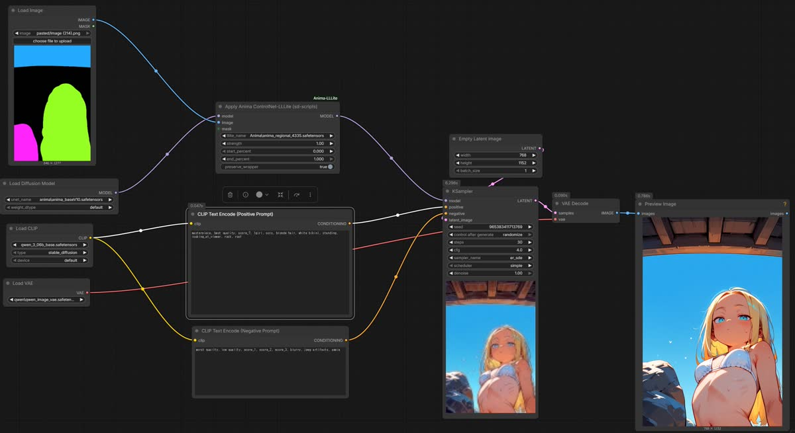
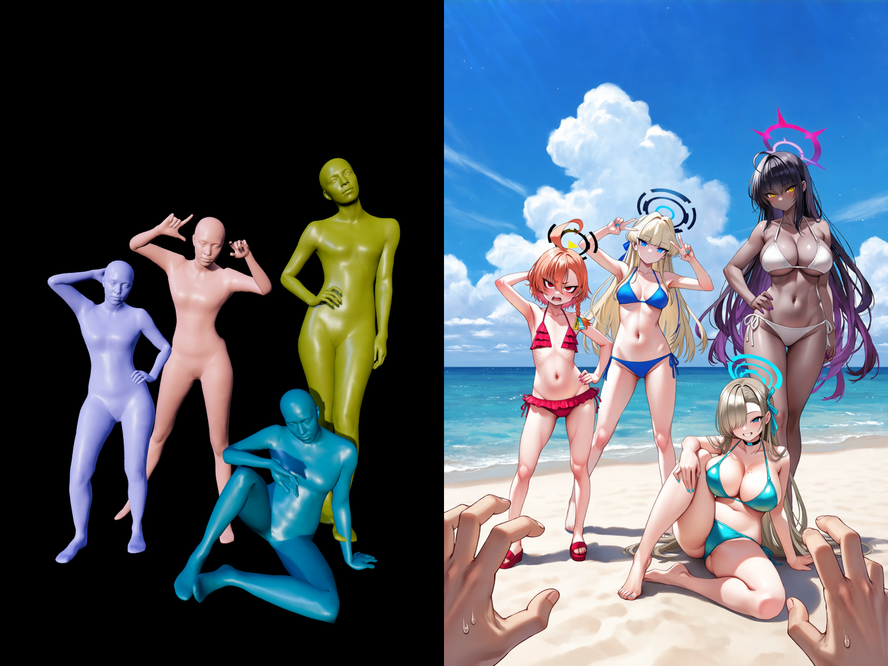
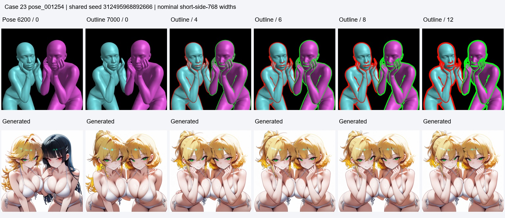

# Anima Control 教程

Anima Control 是「生成时控制」里的一个组件，用 [toyxyz/Anima_ControlNet-LLLite](https://huggingface.co/toyxyz/Anima_ControlNet-LLLite) 的三个 LLLite 适配器，给 Anima 模型加**区域色块**或 **3D 姿态**控制。

> 它替代了旧的「3D 参考」组件；旧 3D 参考已在界面中隐藏。

## 三个模型

| 模型（`models/controlnet/`） | 控制类型 | 适合 |
|---|---|---|
| `anima_regional_4335.safetensors` | RGB 区域色块 | 人物位置、轮廓、多人物布局 |
| `anima_3dpose_6200.safetensors` | 带阴影的 3D 人体网格（含手指） | 指定姿势、手部动作 |
| `anima_3dpose_outline_7000.safetensors` | 3D 网格 + 互补色轮廓 | 人物/手部重叠、需要更清晰边界 |

### 区域色块（Regional 4335）

- 输入是 **3 通道 RGB 色块图**：不同纯色代表不同区域，黑色表示未分配；
- 颜色没有固定语义，不要和黑白遮罩（inpainting）混淆；
- 建议：强度 1.0、作用范围 0%→100%、30 步、CFG 4。

### 3D 姿态（3D Pose 6200）

- 输入必须是**黑底、带阴影的 RGB 3D 人体网格**，不是 OpenPose 线稿、深度图或二值遮罩；
- 插件提供专用 3D 窗口：黑底、无地面网格，拍出来直接就是控制图；
- 建议：强度 1.0、30 步、CFG 4（Anima 的 flow shift 3）。

### 3D 姿态 + 轮廓（Outline 7000）

- 在 3D 网格外加互补色描边，人物互相遮挡、手部交叠时边界更清楚；
- **不是越粗越好**：从 4px 起试，再比较 6/8/12px；
- 参考项目用 `end_percent` 控制区域模型的影响长度（示例 0.3），3D 姿态模型保持 1.0。

## 使用步骤

1. **装节点**：插件检测 `ComfyUI/custom_nodes/ComfyUI-Anima-LLLite`；没有时组件里显示「安装节点」，点击自动 `git clone`，装完重启 ComfyUI。
2. **下模型**：默认不下载。点「下载模型（N）」，插件从 Hugging Face 下载到 `ComfyUI/models/controlnet/`，按钮显示「下载中…」，完成后变「模型已就绪」。
3. **选模型**：在「ControlNet 模型」下拉里选三个之一。
4. **做控制图**：
   - 区域色块：点缩略图 → 图片编辑器（区域模式：画笔 / 橡皮擦 / 油漆桶 / 固定 8 色 / 文字图层）→ 保存；
   - 3D 姿态：点缩略图 → 专用 3D 窗口（黑底、无网格）→ 摆姿势 → 拍摄 → 应用。
5. **调参数**：强度（默认 1.0）、作用范围（默认 0%→100%）。
6. **生成**：启用 Anima control 后，采样设置的宽高和比例会被锁定，显示「使用 Anima 控制图比例」，生成尺寸 = 控制图真实尺寸。控制图与画布比例一致，控制才不会变形。

## 生成链路

插件会自动把控制图接到 ComfyUI：

- 模型名含 `anima_` → `AnimaLLLiteApply_sdscripts`（`lllite_name`、`strength`、`start_percent`、`end_percent`、`preserve_wrapper: true`），输出 MODEL 接到采样器；
- 节点缺失或模型未下载时，生成前会给出明确提示，不会提交半成品工作流。

## 常见问题

- **「场景不存在或过大」**：3D 场景文件超过上限或 sceneId 失效。0.6.249 起上限 16MB，打开前会校验 sceneId，失效则按新临时场景打开。
- **控制图和画布比例不一致**：生成前把 3D 窗口的镜头尺寸调整成和采样设置一致，或让插件锁定尺寸（默认已锁定）。
- **模型下载失败**：检查网络能否访问 `huggingface.co`；重试即可，已下载完成的文件不会重复下载。
